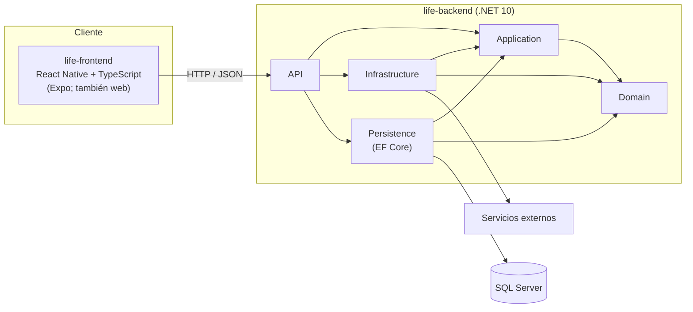

# Arquitectura: ModulApp Life

## Vista general

## Capas del backend (Clean Architecture)

La solución `life-backend/life-backend.slnx` contiene cinco proyectos:

| Capa | Responsabilidad | Referencia a |
|---|---|---|
| `Domain` | Entidades y reglas de negocio | Nadie |
| `Application` | Casos de uso y contratos (interfaces) | `Domain` |
| `Infrastructure` | Implementaciones de servicios externos | `Application`, `Domain` |
| `Persistence` | EF Core, migraciones, acceso a SQL Server | `Application`, `Domain` |
| `API` | Endpoints, `Program.cs`, composición de dependencias | `Application`, `Infrastructure`, `Persistence` |

Un cambio no puede violar esta regla de dependencias.

## Frontend

App móvil React Native con Expo (SDK 57) y TypeScript, que también compila a web con `npm run web`. Consume el
backend por HTTP. La navegación prevista es Expo Router, con las rutas en `src/app/`
(ver [life-frontend/AGENTS.md](../life-frontend/AGENTS.md)).

## Estado actual

Documento inicial (LIF-8). A la fecha:

- El backend es la solución con los cinco proyectos y un endpoint de ejemplo (`/weatherforecast`) en `API`.
- `Application`, `Domain`, `Infrastructure` y `Persistence` aún no tienen código.
- El frontend es el proyecto base de Expo (`App.tsx`, `index.ts`), sin `src/` ni navegación.

Este documento se completa a medida que los tickets siguientes definan casos de uso, entidades y pantallas.

## Entornos y ramas

La estrategia de ramas (`dev-* → review → main → release/<año>`) está en el [README](../README.md).
