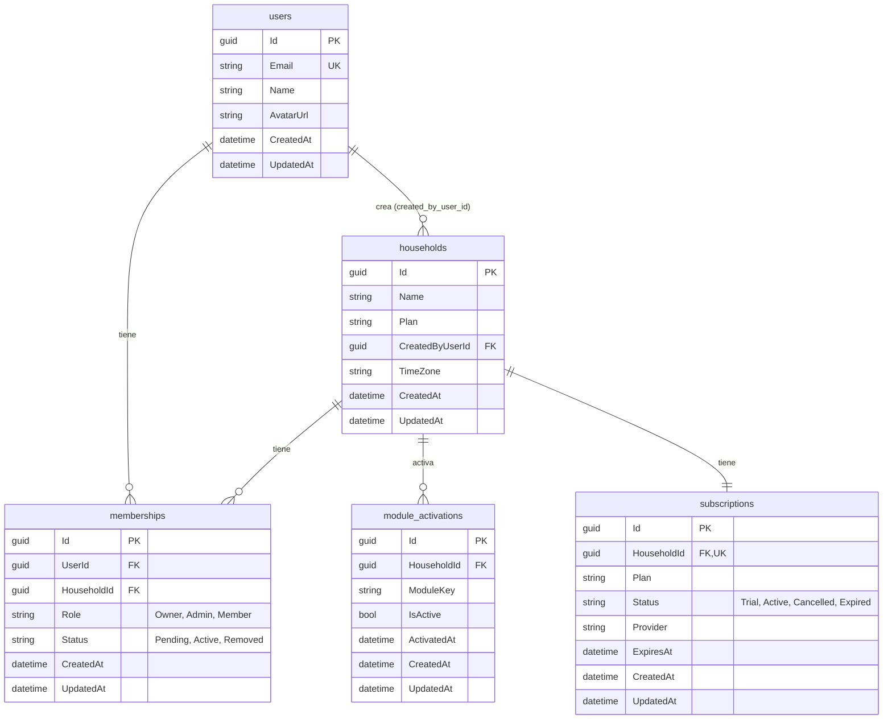

# Modelo de datos inicial (LIF-5)

Núcleo de datos del MVP según Documentación de Producto 3.3. Las entidades viven en `life-backend/Domain/Entities`
y su mapeo a SQL Server en `life-backend/Persistence/Configurations`.

## Diagrama entidad-relación



## Índices y restricciones

| Tabla | Índice | Motivo |
|---|---|---|
| `users` | único en `Email` | Un correo, una cuenta |
| `households` | `CreatedByUserId` | FK (sin cascada, `Restrict`) |
| `memberships` | `UserId` | Pedido por el ticket: hogares de un usuario |
| `memberships` | único en `(HouseholdId, UserId)` | Un usuario no se repite en un hogar |
| `module_activations` | único en `(HouseholdId, ModuleKey)` | Un registro por módulo y hogar |
| `subscriptions` | único en `HouseholdId` | Relación 1:1 con el hogar |

## Decisiones

- Claves `Guid`; auditoría (`CreatedAt`, `UpdatedAt`) en UTC, completada en `ApplicationDbContext.SaveChangesAsync`.
- `Role`, `Status` (memberships) y `Status` (subscriptions) son enums guardados como texto.
- `users` no guarda contraseña: la autenticación (LIF-22) agregará lo que necesite en su propia migración.
- Aislamiento por hogar: las entidades con `HouseholdId` implementan `IHouseholdScoped` y se consultan con
  `.ForHousehold(householdId)` (`Persistence/HouseholdScopeExtensions.cs`).
- Borrado de cuenta (LIF-36, `DELETE /me`): la fila de `users` se conserva anonimizada (correo
  `deleted-<id>@deleted.invalid`, nombre "Usuario eliminado", sin avatar ni hogar activo) porque `households.CreatedByUserId`
  y `events_log.ActorUserId` impiden el borrado físico. Se eliminan credenciales, logins externos y refresh tokens. En cada hogar
  del usuario: si hay otro administrador solo sale; si era el único administrador, la administración pasa al miembro activo
  más antiguo; si era el único miembro, se elimina el hogar. El access token ya emitido sigue siendo válido hasta 15 minutos
  (`Jwt:AccessTokenMinutes`), pero las rutas de hogar ya lo rechazan por la pertenencia.
- Fuera de alcance: `tasks`, `lists`, `events`, `reminders`, `notes` y `events_log`.

## Migración y datos de prueba

Con una cadena de conexión configurada (ver README, sección Base de datos):

```bash
cd life-backend
dotnet ef migrations add InitialCreate --project Persistence --startup-project API
dotnet ef database update --project Persistence --startup-project API
```

El seed de desarrollo (`DevelopmentDataSeeder`) se ejecuta al iniciar la API solo en `Development` y con
`Database:SeedOnStartup=true` (user-secrets o `appsettings.Development.local.json`). Es idempotente.
